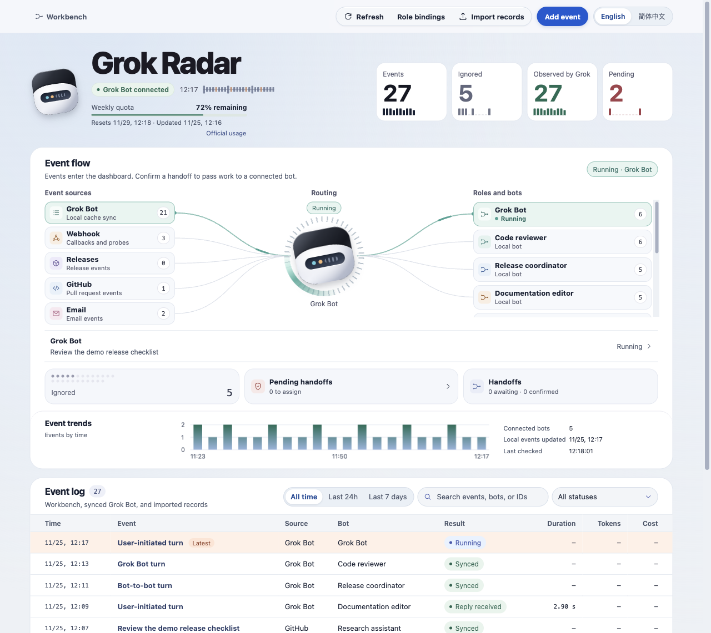

# Grok Radar

A local macOS dashboard for Grok Bot. See which bots are working, read turns from the local conversation cache, and check the remaining weekly quota.

[简体中文](README.md) · [Contributing](CONTRIBUTING.md) · [Changelog](CHANGELOG.md)



*Screenshot uses synthetic data.*

Radar opens in English on first launch unless your preferred system language is Chinese. **English** and **简体中文** are always visible in the top-right corner and switch languages directly.

## Build and run

Use an Apple Silicon Mac running macOS 13 or later with Xcode Command Line Tools. For live monitoring and handoffs, install the official client at `/Applications/Grok Bot.app` and sign in.

```sh
bash mac/build.sh './Grok Radar.app'
open './Grok Radar.app'
```

Keep one unminimized client window open with the bot sidebar visible. In Radar, choose **Connect live status** and grant Grok Radar Accessibility access in macOS Privacy & Security. Some macOS versions call the pane **Device Control and Data Access**. Choose **Refresh** to check the connection. A locally signed rebuild may need a fresh grant.

## Common tasks

- Running bots appear first. Radar pauses polling while the Mac or its display sleeps and refreshes on wake.
- Open an event to read the user and bot messages available in the local cache. The weekly quota shows the cached value and its update time.
- Assign default bots to routing roles. A handoff opens the official client and prefills the draft when its input field is empty. You confirm sending there. Radar links the matching receipt to the original event.
- To try imports in a browser, run `python3 -m http.server 8317 --bind 127.0.0.1` in this directory. Open [the preview](http://127.0.0.1:8317/), choose **Import records**, and load the [sample workflow](examples/workflow.json).

Grok Radar is an independent project. Live status may be unavailable when there is only one bot or too few sidebar entries match the local roster. The event log can still sync if the local cache remains readable. See [Security and privacy](SECURITY.md) for data handling and [Releasing](docs/releasing.md) for build signing. Licensed under [MIT](LICENSE).
