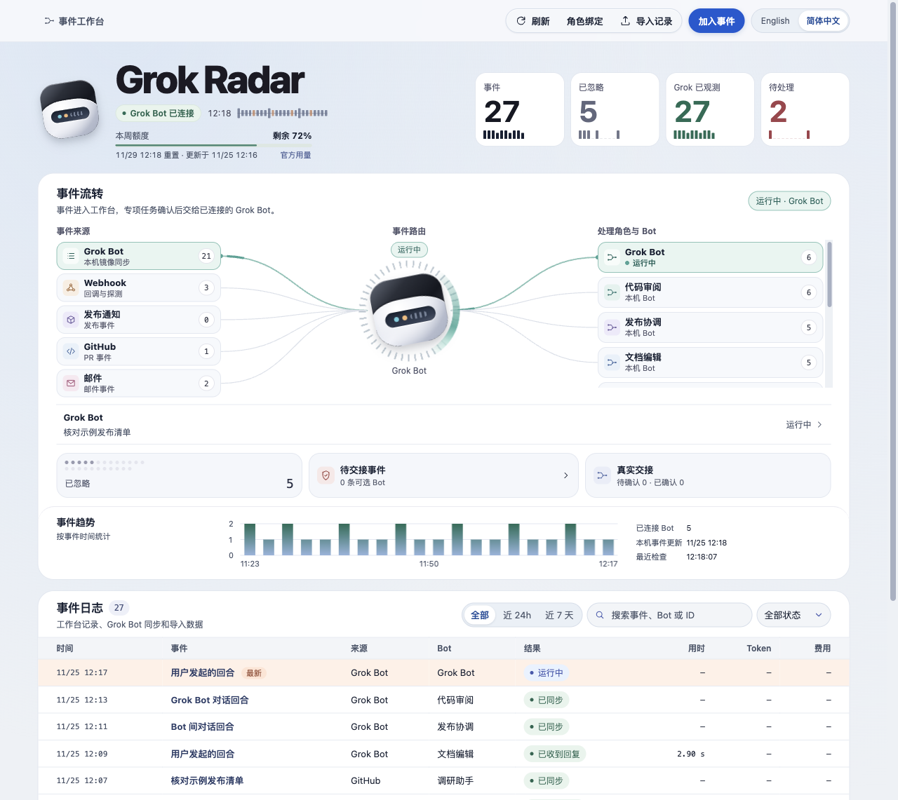

# Grok Radar

在 Mac 上看 Grok Bot 正在做什么。Grok Radar 把 Bot 的运行状态、事件日志和每周剩余额度放在一个窗口里，也可以把工作台事件交给指定的 Bot。

[English](README.en.md) · [贡献指南](CONTRIBUTING.md) · [版本记录](CHANGELOG.md)



*界面使用合成数据。*

首次打开时，系统首选语言为中文则显示简体中文，其余语言显示 English。右上角始终显示 **English** 和 **简体中文**，点击即可切换。

## 能做什么

- **看谁在运行。** 正在工作的 Bot 会置顶，路径动画在确认空闲后停止。Mac 睡眠或屏幕熄灭时暂停读取，唤醒后自动同步。
- **查一轮对话。** 点击事件，查看本机缓存里可用的用户提问和 Bot 回复。新回复写入缓存后，重新打开详情即可查看。
- **交接事件。** 为 TRIAGE、FIXER、REVIEWER、WRITER 绑定常用 Bot。点「确认交给 Bot」后，Radar 会打开 Grok Bot 客户端，输入框为空时预填草稿。发送需要在客户端确认，匹配的回执会并回原事件。
- **看额度和用量。** 每周额度来自 Grok Bot 的本机缓存，界面显示采集时间。也可以导入工作流 JSON、Grok 或 Cursor 用量 CSV，以及 Cursor Enterprise OTLP JSON。

## 从源码运行

需要 **Apple Silicon Mac 和 macOS 13 或更高版本**，以及 **Xcode Command Line Tools**。实时状态和交接需要已登录的官方客户端，安装路径为 `/Applications/Grok Bot.app`。网页预览只需要 Python 3 和浏览器。

下载或克隆此仓库，在项目目录运行：

```sh
bash mac/build.sh './Grok Radar.app'
open './Grok Radar.app'
```

1. 打开 Grok Bot 并登录，只保留一个未最小化的客户端窗口，让 Bot 侧栏保持可见。
2. 首次连接时，在 Radar 的「事件流转」中点「连接实时状态」。打开 macOS「隐私与安全性」里的「辅助功能」。部分 macOS 版本将它显示为「设备控制和数据访问」。给 **Grok Radar** 开启权限。
3. 回到 Radar 点「刷新」。运行状态、事件和额度会显示各自的检查结果。

本地构建默认使用临时签名。重新构建后，如果权限开关已打开但 Radar 仍要求授权，可在系统设置移除旧的 **Grok Radar** 条目，再为当前构建授权。若要跨版本沿用授权，请用同一个 Apple 签名身份构建。签名与首发步骤见[发布说明](docs/releasing.md)。

## 试用导入功能

```sh
python3 -m http.server 8317 --bind 127.0.0.1
```

打开 [本机网页预览](http://127.0.0.1:8317/)，在「导入记录」里选择[示例文件](examples/workflow.json)。导入文件上限为 10 MB 或 50,000 条记录。工作流 JSON 的时间带时区，费用用 USD，缺失的用量列显示为「—」。浏览器预览支持导入、筛选和查看详情。

## 数据与兼容性

Radar 是独立项目。常规同步读取 Grok Bot 保存的本机名册、会话缓存和额度缓存。会话详情按需读取，工作台事件与绑定保存在本机账本里，导入数据保存在应用或网页的 WebKit／浏览器存储中。Radar 通过 macOS 辅助功能读取官方客户端侧栏的工作状态。

聊天记录和额度的更新时间由客户端缓存决定。客户端的缓存格式或侧栏结构变更、多个账号的缓存并存，都可能影响同步。只有一个 Bot 或侧栏与本机名册匹配不足时，Radar 可能暂时读不到实时状态，事件日志仍可能更新。数据范围和报告方式见[安全与隐私](SECURITY.md)。

## 贡献与许可

欢迎提交可复现的问题、文档修订和小范围改进。[贡献指南](CONTRIBUTING.md)列出了构建和测试命令。

采用 [MIT License](LICENSE)。Grok Bot 与 Cursor 的名称用于描述兼容性。会话缓存资料参考了 [CodeBurn 的 Grok Bot provider 文档](https://github.com/getagentseal/codeburn/blob/main/docs/providers/grokbot.md)，交接链接见 [Grok Bot 官方文档](https://docs.x.ai/grok-bot/deep-links)。
